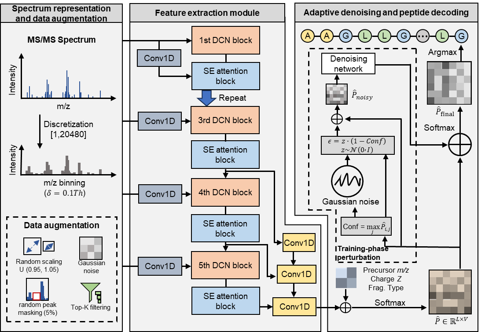

# DenNovo

Reference implementation of **DenNovo: an accurate and robust physics-informed denoising network for de novo peptide sequencing**.

DenNovo maps tandem mass spectra to peptide sequences using a multi-scale one-dimensional dilated convolutional encoder, precursor-aware feature conditioning, adaptive probability-space denoising, and a differentiable expected-mass regularizer. This repository provides the training, inference, and evaluation code used to implement the method described in the manuscript.

## Method overview



**Figure 1 | Overview of the DenNovo framework.** MS/MS spectra are discretized into dense representations and subjected to spectrum-level augmentation during training. Multi-scale dilated convolutional blocks and squeeze-and-excitation attention extract spectral features, which are conditioned on precursor information before peptide decoding. A confidence-adaptive denoising module perturbs and refines the initial residue-probability distribution during training to produce the final sequence prediction.

## Repository contents

| File | Description |
| --- | --- |
| `train.py` | Canonical DenNovo architecture, preprocessing pipeline, losses, and training workflow for predefined training and validation sets |
| `train_split811.py` | Peptide-level 8:1:1 train/validation/test workflow based on the canonical implementation |
| `denovo.py` | De novo prediction for unlabeled MGF files |
| `evaluation.py` | Amino-acid- and peptide-level evaluation using the manuscript mass-matching criteria |
| `denovo_utils.py` | Shared decoder and mass-based evaluation utilities |
| `tests/test_denovo_utils.py` | Unit tests for decoding, residue matching, token definitions, and source-language checks |
| `requirements-rtx3090-4090.txt` | Environment profile for RTX 3090/4090 systems |
| `requirements-rtx5090.txt` | Environment profile for RTX 5090 systems |
| `CITATION.cff` | Software citation metadata |

All executable workflows import the same model definition from `train.py`. Checkpoints generated by either training entry point can therefore be loaded by `evaluation.py` and `denovo.py`.

## System requirements

### Software

- NumPy
- Numba
- Pyteomics
- tqdm

Two GPU-specific environment profiles are provided.

**RTX 3090 / RTX 4090**

- Python 3.7 or later
- TensorFlow 2.5.0 or later
- TensorFlow Addons
- Pandas 0.20 or later

```bash
python -m venv .venv
source .venv/bin/activate
python -m pip install --upgrade pip
python -m pip install -r requirements-rtx3090-4090.txt
```

**RTX 5090**

- Python 3.10
- `tf-nightly` 2.21.0.dev20251208
- `keras-nightly` 3.12.0.dev2025100703
- Pandas 2.3.3

```bash
python -m venv .venv
source .venv/bin/activate
python -m pip install --upgrade pip
python -m pip install -r requirements-rtx5090.txt
```

CUDA, cuDNN, and driver installation should follow the requirements of the selected TensorFlow build and the target system.

### Hardware

Training uses a dense spectrum representation and is intended for GPU execution. GPU memory requirements depend on the batch size and TensorFlow build. A batch size of 64 was used as the manuscript default; smaller values can be supplied through `--batch-size` when memory is limited. Evaluation and inference also support CPU execution, but will be slower.

## Data

The manuscript uses the following public resources:

| Resource | Accession |
| --- | --- |
| Revised nine-species benchmark | [MassIVE MSV000090982](https://doi.org/10.25345/C52V2CK8J) |
| Processed 8:1:1 benchmark data and merged-benchmark model weights | [Zenodo 20543543](https://doi.org/10.5281/zenodo.20543543) |
| Leave-one-species-out model weights | [Zenodo 20558272](https://doi.org/10.5281/zenodo.20558272) |
| Antibody evaluation datasets | [Zenodo 20579787](https://doi.org/10.5281/zenodo.20579787) |

Data files and pretrained weights are not duplicated in this repository. Place downloaded files in user-defined directories and pass their paths explicitly to the command-line interfaces.

## MGF input conventions

Training and evaluation require peptide annotations in the `SEQ` field. De novo prediction does not require `SEQ`.

```text
BEGIN IONS
TITLE=example_scan_1
PEPMASS=523.2761
CHARGE=2+
SEQ=PEPTIDE
100.10 1200.0
175.12 950.0
END IONS
```

The implementation applies the following preprocessing conventions:

| Setting | Value |
| --- | --- |
| Spectrum range | 0-2048 m/z |
| Bin width | 0.1 Da |
| Bins per channel | 20,480 |
| Spectrum channels | 4 |
| Maximum peptide length | 30 residues |
| Output length | 32 tokens |
| Vocabulary | padding, 20 standard amino acids, oxidized methionine (`Z`), end (`]`), start (`[`) |
| Intensity transform | double square root after maximum-intensity normalization |
| I/L handling | `I` is converted to `L` |
| Cysteine convention | fixed carbamidomethylated residue mass |
| Precursor filter | absolute mass error no greater than 10 ppm |
| Fragment calibration | `m/z / 1.00052` |

Spectra that do not satisfy the annotation, peptide-length, or precursor-mass requirements are excluded from labeled training and evaluation.

## Model training

### Predefined training and validation sets

```bash
python train.py \
  --train-mgf /path/to/train.mgf \
  --val-mgf /path/to/validation.mgf \
  --frag hcd \
  --batch-size 64 \
  --epochs 50 \
  --output-dir outputs/standard
```

The training directory contains:

```text
outputs/standard/
├── denovo_best.weights.h5
└── training_log.csv
```

The initial learning rate follows the manuscript batch-size scaling rule:

```text
learning_rate = (batch_size / 1024) × 0.0009 × 16 × 6
```

An explicit value can be supplied with `--learning-rate`.

### Peptide-level 8:1:1 workflow

```bash
python train_split811.py \
  --mgf /path/to/all_labeled_spectra.mgf \
  --frag hcd \
  --batch-size 64 \
  --epochs 50 \
  --output-dir outputs/split811
```

Spectra assigned to the same normalized peptide are retained in a single subset to prevent peptide leakage. The current stratification tag incorporates precursor charge, peptide length, normalized collision energy, and instrument information when available.

The output directory contains the best checkpoint, training log, Keras diagnostic metrics, and manuscript-aligned test metrics:

```text
outputs/split811/
├── denovo_best.weights.h5
├── training_log.csv
├── test_metrics.json
└── test_paper_metrics.json
```

## Evaluation

```bash
python evaluation.py \
  --mgf /path/to/test.mgf \
  --model outputs/standard/denovo_best.weights.h5 \
  --frag hcd \
  --batch-size 128 \
  --width 5 \
  --metrics-output results/test_metrics.json \
  --predictions-output results/test_predictions.csv
```

A predicted residue is counted as matched when:

1. its mass differs from the aligned target residue by less than 0.1 Da; and
2. either the prefix-mass or suffix-mass difference is no greater than 0.5 Da.

The evaluator reports amino-acid precision, amino-acid recall, peptide precision, peptide recall, and the distribution of incorrect predictions containing 1, 2, or at least 3 residue errors. A peptide is counted as correct only when all residues match and the predicted and target sequence lengths are equal.

## De novo prediction

```bash
python denovo.py \
  --mgf /path/to/unlabeled.mgf \
  --model outputs/standard/denovo_best.weights.h5 \
  --output results/predictions.csv \
  --frag hcd \
  --batch-size 128 \
  --width 5
```

`--beam` is accepted as an alias for `--width`. The output CSV contains the spectrum index, title, precursor m/z, charge, predicted peptide, and sequence score.

Inference is deterministic for fixed model weights and inputs. Confidence-adaptive Gaussian perturbation is applied only during training. The decoder uses the final refined probability distribution and does not introduce an additional precursor-mass penalty at inference time.

## Optimization settings

| Parameter | Default |
| --- | --- |
| Optimizer | Adam |
| Batch size | 64 |
| Maximum epochs | 50 |
| Random seed | 42 |
| Label smoothing | 0.1 on the final peptide output |
| Expected-mass coefficient | 0.01 |
| Final peptide loss weight | 2.0 |
| Initial and denoised auxiliary loss weights | 1.0 each |
| Learning-rate reduction | factor 0.5 after 5 epochs without improvement |
| Minimum learning rate | `1e-6` |
| Early stopping | patience 6, minimum delta `1e-4`, restore best weights |

Training augmentation includes random intensity scaling, additive Gaussian noise, peak dropout, and intensity-based filtering of dense spectra. Augmentation is disabled for validation, testing, and inference.

## Tests

Utility tests can be run without TensorFlow after NumPy is installed:

```bash
python -m unittest discover -s tests -v
```

The command-line interfaces can be inspected with:

```bash
python train.py --help
python train_split811.py --help
python evaluation.py --help
python denovo.py --help
```

Full model validation requires a compatible TensorFlow/Keras environment and representative MGF data. Exact numerical reproducibility across GPU models can be affected by nondeterministic convolution and distributed-reduction kernels.

## Checkpoint compatibility

Checkpoints produced by earlier versions of the scripts are not guaranteed to load in this implementation. This release uses explicit start and end tokens, a unified GroupNormalization/SE architecture, corrected denoising behavior, and an active expected-mass loss. Retraining with the current code is recommended.

## Citation

If you use DenNovo in academic work, please cite:

> Zhang, Q. et al. DenNovo: an accurate and robust physics-informed denoising network for de novo peptide sequencing (2026).


## Contact

Correspondence regarding the method may be addressed to Dong-Jun Yu (`njyudj@njust.edu.cn`).
